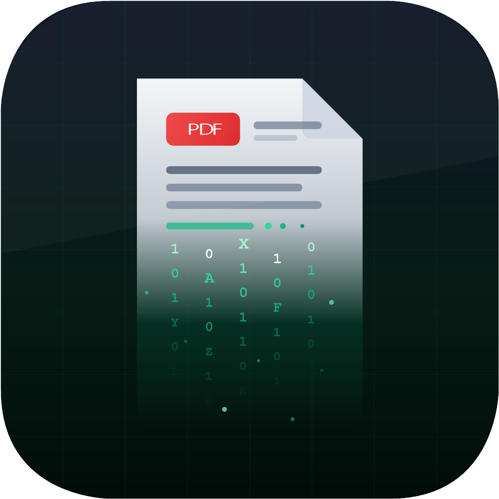

# Pdf To Usb



Small Android app that copies the PDFs you open from USB drive **A** into the folder
`pdf-to-usb` on USB drive **B**, with no computer in between.

- **A** is the source drive: the stick that holds your PDFs. Open a PDF from it with any
  reader you like (Adobe Acrobat, Foxit, Xodo, PDF Viewer, or any other app).
- **B** is the receiving drive: the app writes the copy into `B/pdf-to-usb`.

The app listens to drive A from a foreground service (kernel `ACCESS` events), so the
reader does not have to be this app. A PDF sent to it with "Open with" or "Share" is
copied as well.

## What it does

- watches every USB stick except the receiving one: whichever stick you open a PDF from
  becomes the source, so it does not matter which one was plugged in first
- finds the receiving drive B by itself and proposes it (one system confirmation is still
  required, Android does not allow an app to grant itself write access to a USB stick)
- foreground service with a notification, a copy queue, 3 retries per file
- stays ready with the screen off: restarts at boot, after an app update and when the app is
  reopened, and **Keep running in background** asks Android to leave it out of battery
  optimization (a normal system dialog)
- dedupe by name and size; a different PDF with the same name becomes `name (2).pdf`
- English by default, with 57 languages taken from
  [vivizzz007/vivi-music](https://github.com/vivizzz007/vivi-music), picked from the bottom
  bar (**Language**) or from the Android language
- automatic update from this repository's GitHub releases, plus a **Check for updates**
  button in the bottom bar

## Requirements

Android 5.0 to 9.0 (`minSdk 21`, `targetSdk 28`). Android 4.x is not supported: the SAF
directory picker starts at Android 5.0 and secondary storage is read-only for normal apps
before that. Both USB drives must be connected at the same time.

## Install

Download the APK from [Releases](https://github.com/PiBOH/pdf-to-usb/releases) and install
it (Android asks once for "install unknown apps"). Then:

1. Plug both sticks in, open the app and allow reading storage (used by the watcher).
2. The app proposes drive B (the receiving stick): tap **Choose drive B** and confirm the
   volume already selected. The app creates `pdf-to-usb` there and starts listening on the
   other stick, whichever one it is.
3. Open a PDF from drive A with any reader.

With only one stick, or if the detection does not fit, the two pickers still let you choose
A and B by hand, then **Start listening**.

If nothing is copied, use **Test detection on A** (look at the log) and **Copy all PDFs
from A now**: details in [docs/NOTE.md](docs/NOTE.md).

## Build

```
./gradlew :app:assembleDebug        # app/build/outputs/apk/debug/app-debug.apk
./gradlew :app:assembleRelease      # signed, needs keystore.properties
./gradlew :app:testDebugUnitTest
```

JDK 17+ (CI uses 21) and Android SDK 35. The version lives only in [version.txt](version.txt).
Regenerate the launcher icons from `matrix_logo.svg` with `python3 tools/icons.py`.

## Updates

The app checks the latest GitHub release at most every 6 hours (or immediately when you tap
**Check for updates**), downloads the APK and opens the system installer. A completely silent
install is not possible: Android always asks for "install unknown apps" once and always
shows its install confirmation, and no app can skip them without a system signature or root. Android always asks for "install unknown apps" once and always shows
its install confirmation; Play Protect may show a warning for APKs that do not come from
the Play Store. No app can skip those dialogs. Updates install only if the new APK is
signed with the same key as the installed one.

## License

This program is distributed under the **UNLICENSE** on purpose. Its use is entirely at the
user's own risk and peril: the creator claims **no copyright** and assumes **no
responsibility or liability of any kind** (none whatsoever) for any damage, data loss,
corrupted USB drives, lost files or any other consequence of using it, in any jurisdiction,
to the maximum extent permitted by law. See [LICENSE](LICENSE).

Documentation: [docs/NOTE.md](docs/NOTE.md) for technical notes and limits,
[AGENTS.md](AGENTS.md) for instructions to coding agents.
